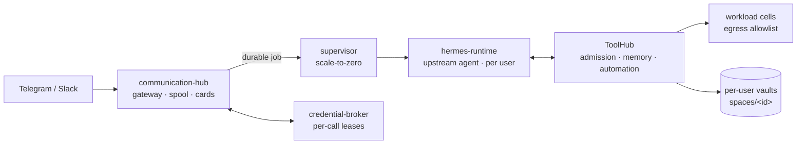

<p align="center">
  <strong>English</strong> · <a href="README.ru.md">Русский</a>
</p>

# hermes-hub

[](https://github.com/letya999/hermes-hub/actions/workflows/ci.yml)
[](LICENSE)
[](go.mod)
[](https://github.com/letya999/hermes-hub/milestones)

**A reliability and security wrapper around the upstream
[Hermes](https://github.com/nousresearch/hermes-agent) agent CLI.** One Go
control plane turns a single-user agent binary into a self-hosted multi-user
appliance: your agent lives in Telegram, gets tools through a policy gateway,
touches secrets only per call, survives restarts, and shares one host with
other isolated users.

Hermes does the thinking; hermes-hub makes it safe to run for real people —
durable queues, scale-to-zero supervision, per-call admission, credential
brokering and an auditable record of everything that happened.

## Why a hub around Hermes

Running the bare agent means shared environments, baked-in tokens, no tenant
isolation and no way to answer "who allowed this call". hermes-hub wraps it:

| Concern | Bare agent CLI | hermes-hub |
|---|---|---|
| Secrets | env vars in the agent process | credential broker — per-call leases, values never reach chat, logs or audit |
| Tool access | whatever is configured | ToolHub admission — default-deny, per-principal rights checked on every call |
| Configuration | loose config files | six authored passports — sole authority, atomic revisions, fail-closed compile |
| Multi-user | one user, one machine | `spaces/<id>` isolation — per-user homes, vaults, egress, org ceilings |
| Reliability | process dies, work lost | durable job spool, receipts, bounded journals, supervised restarts |
| Idle cost | always-on container | supervisor scale-to-zero — 30-min warm lease, cold restore |
| Audit | none | bounded audit ledger — every admitted call has a durable reason |

## How it works — four everyday uses

1. **A personal agent in your messenger.** Write or talk to it in Telegram
   (Slack works too): it keeps the conversation, executes jobs, and delivers
   documents, images and video back into the chat. STT and TTS are built-in
   services — voice notes just work.
2. **A team agent under a policy ceiling.** An org space carries membership,
   approved connectors and shared skills. Every member gets an isolated
   runtime and vault; the org can narrow rights, never widen them.
3. **Automation that outlives the session.** Routines, site watchers,
   standing assignments and per-user dreaming run inside ToolHub — they keep
   firing while no agent is awake, and results arrive as ordinary messages.
4. **A safe way to give a model real tools.** Attach MCP servers, GitHub, a
   browser, SSH or files. Every call passes ToolHub admission, credentials are
   leased per call, and the audit ledger answers "who allowed this".

## Architecture



The gateway owns the conversation; the supervisor spawns the right user's
runtime on demand and shuts idle compute down. ToolHub decides which tools the
model may see *for this principal*; the broker hands out credentials per call
instead of baking them into environments. Every admission decision lands in a
bounded audit ledger.

## Compared to alternatives

### Free and open source

| Project | Kind | Multi-user | Secrets | Admission / audit | Durable runs | Owned memory |
|---|---|---|---|---|---|---|
| **hermes-hub** | self-hosted agent appliance | ✅ per-space | broker, per-call | ✅ | ✅ + scale-to-zero | ✅ vault |
| hermes-agent (naked) | agent CLI | ❌ | env vars | ❌ | ❌ | ⚠️ files |
| OpenClaw | personal agent gateway | ❌ | ⚠️ | ⚠️ | ⚠️ | ⚠️ |
| Eve | agent harness | build it | ⚠️ | ⚠️ | ❌ | ⚠️ |
| NanoClaw | minimal harness | ❌ | ❌ | ❌ | ❌ | ❌ |
| IronClaw | hardened runtime | ⚠️ | ⚠️ | ⚠️ | ⚠️ | ⚠️ |
| OpenDuet | paired-agent harness | ⚠️ | ⚠️ | ⚠️ | ⚠️ | ⚠️ |
| OpenDot | agent framework | build it | ⚠️ | ⚠️ | ⚠️ | ⚠️ |
| Paperclip | agent platform | ⚠️ | ⚠️ | ⚠️ | ⚠️ | ⚠️ |

### Commercial assistants and bots

| | hermes-hub | Muse (Meta) | OpenAI Dot | Claude Duet | Grok (xAI) | Instinct |
|---|---|---|---|---|---|---|
| Self-hosted, your infrastructure | ✅ | ❌ | ❌ | ❌ | ❌ | ❌ |
| Pick your model and provider | ✅ | ❌ | ❌ | ❌ | ❌ | ❌ |
| Multi-user isolation | ✅ | ❌ | ❌ | ❌ | ❌ | ❌ |
| Tool admission + audit trail | ✅ | ❌ | ❌ | ⚠️ | ❌ | ❌ |
| Secrets never leave your host | ✅ | ❌ | ❌ | ❌ | ❌ | ❌ |
| Memory as your own files | ✅ | ⚠️ cloud | ⚠️ cloud | ⚠️ cloud | ⚠️ cloud | ⚠️ cloud |
| Open source / free | ✅ AGPL | ❌ | ❌ | ❌ | ❌ | ❌ |

The niche moves fast — ⚠️ means "partial or not the product's focus"; verify
the current state before betting a design on any cell.

## Quick start

Requires Docker Engine/Desktop with Compose 2.30+. Grab a platform binary from
the latest release; Go is only needed to build from source.

```bash
./bin/hubctl-linux-amd64 init --user artem
# Edit spaces/artem/passports/{stack,config,models,workspace,tools,grants}.yaml and secrets.prod.env
./bin/hubctl-linux-amd64 space apply --dir spaces/artem --env prod --confirm
./bin/hubctl-linux-amd64 doctor --user artem
./bin/hubctl-linux-amd64 up --user artem --env prod
./bin/hubctl-linux-amd64 chat --user artem
```

Set a reviewed default route in `passports/models.yaml` and the provider
credential in `secrets.prod.env`. On Windows use the included `.exe` and Docker
Desktop Linux containers. Start with 4 vCPU, 8 GB RAM, 30 GB free disk — see
[Resource requirements](#resource-requirements) for multi-user sizing.

## Organizations

Users and orgs share one namespace (`spaces/<id>`). An org carries membership,
approved connectors, shared skills and policy ceilings — members can narrow,
never widen.

```bash
./bin/hubctl-linux-amd64 org-init --org acme --user artem
./bin/hubctl-linux-amd64 init --org acme --user artem
./bin/hubctl-linux-amd64 org sync-members --org acme --org-dir spaces/acme
```

## Resource requirements

Honest engineering estimates from the dev stack, not benchmark marketing —
measure against your own load before buying a VPS.

**Baseline (always-on control plane):** supervisor, communication-hub,
ToolHub, credential-broker, model-relay — about **1 vCPU / 2 GB RAM** idle,
plus ~5 GB of hub images on disk.

**Per user:**

- stopped runtime: ~0 CPU/RAM — only disk state remains
- warm/active runtime: **~0.3–0.5 vCPU / 0.5–1 GB RAM**
- optional browser sidecar: **+0.5 vCPU / 1–2 GB RAM**
- voice (STT/TTS): shared service pool, ~1–2 GB RAM total
- disk: ~0.5–2 GB per user (vault, workspace, state) — more for media-heavy use

The scale-to-zero supervisor means you size for **concurrent** users, not
registered ones. ~30% online at once is a safe default assumption.

| Deployment | Assumption | vCPU | RAM | Disk |
|---|---|---|---|---|
| 1–2 users | 1 active runtime + browser | 4 | 8 GB | 30 GB |
| 10 users | ~3 concurrent runtimes | 4–6 | 12 GB | 60 GB |
| 100 users | ~30 concurrent runtimes | 16–24 | 48 GB | 300+ GB |

A single Docker host tops out near the 10-user row — past ~30 runtimes,
container overhead and the image store become the bottleneck. That workload
is exactly what the microVM/Kubernetes roadmap is for.

## Roadmap

- **microVM isolation** — per-user runtimes in dedicated microVMs instead of
  containers, for a harder security boundary.
- **Kubernetes** — optional native backend for managed gateway spaces beside
  Docker, with retained PVCs and per-space network isolation; see
  [operations](docs/operations.md#optional-kubernetes-space-execution).
  Multi-host capacity and HA acceptance remain ahead.
- **Bare metal** — installation on a plain Linux host without Docker Desktop.

## Feature inventory

97 model tools across 21 first-party families plus the pinned platform layer —
everything below rides through ToolHub admission:

- **Chat channels:** Telegram first-class + Slack — text, voice notes, files
  in; cards, documents and media delivered back. Per-user UI locale in 4
  languages.
- **Voice & speech:** faster-whisper STT service, TTS service,
  `media_transcribe` with measured timestamp segments, `media_speak` queued
  speech to the chat.
- **Files & workspace:** full file surface (`file_list/read/search/write/
  edit/mkdir/archive/remove`) over admitted roots — workspace, archive,
  organization, skills, knowledge; revision-guarded writes; `project_create`
  for new project dirs; inbox file transfer.
- **Documents:** extract/create/edit/convert/remove for txt, md, csv, html,
  pdf, xlsx, pptx, webp — all inside the admitted scope, no external
  converters in the base image.
- **Media:** inspect 1–8 images per call, convert, image and video
  generation (CLIProxy/Fal), fetch, transcribe, speak.
- **Memory & recall:** per-user markdown vault (leaves → typed cards → folded
  summaries → CORE.md), BM25+graph `memory_search` with file:line evidence,
  governed `memory_card` writes confirmed by the owner, deterministic nightly
  rollup, dreaming, read-only `memory_open` links + OpenKnowledge surface.
- **Automation:** routines (once/after/cron/interval windows), site watchers
  with Starlark filters over up to 32 sources, event subscriptions, durable
  standing assignments, per-conversation goals.
- **Sessions & parallel work:** named sessions as chat task handles —
  list/search/read/create/switch/archive; conversation lanes run parallel
  sessions inside one context with per-context fairness; bounded worker pool
  at the gateway.
- **Context control:** dual-engine compaction (hub cheapest-first cascade +
  native Hermes), live token estimate, turn-boundary `context_edit`.
- **Terminal & CLI:** bounded `terminal_exec`/`terminal_job` — allowlisted
  binary, fixed argv, workspace snapshot cwd, no shell, background jobs;
  bounded-CLI connector transport with controller-verified cells; private
  package cells.
- **SSH:** declared hosts only — read/write/exec, interactive `ssh_shell`,
  `ssh_tunnel` port forwarding.
- **Connectors & MCP:** curated catalog (GitHub, GitLab, Google Workspace,
  Slack, Atlassian, personal Telegram) behind a 9-verb `connector_*` surface;
  prepared sources with tier digests, team connections, recipe-driven OAuth,
  one-time human-action links; raw `user_mcp`/`org_mcp` for uncurated
  servers.
- **Browser:** per-connection Chromium with an isolated profile,
  `browser_open/read/act/capture`, one-time owner viewer links, deny-first
  web egress proxy.
- **Web & research:** `web_search`/`web_fetch`/`web_search_multi` with
  provider allowlists and cache, durable `research_*` deep-research jobs.
- **Sites & exposure:** static site publish/hosting per user, DNS/TLS layer,
  named sish tunnels (`exposure_*`), per-user subdomains.
- **Models:** per-owner Model Relay — `model_list`/`model_switch`, bounded
  fallback ladders, usage metering.
- **Skills:** agentskills.io format, `skill`/`skill_search`/`skill_edit`
  draft-first writes, approval-card publication, compat normalization
  (Hermes/OpenClaw/Codex/Claude Code), pinned git installs.
- **Settings & config:** six authored passports as the sole configuration
  authority, `settings_read`/`settings_edit` over a reviewed allowlist,
  revision-fenced publish.
- **Governance:** default-deny ToolHub admission, `rights.yaml` vocabulary,
  PDP/PEP, bounded audit ledger, per-call credential leases from the broker.
- **Operations:** scale-to-zero supervisor, durable spool with receipts,
  SQLite root stores, bounded journals, image-pin rollouts, `usage.jsonl`
  export.

## Engineering

`just check` is the fast local gate (format, docs, vet). GitHub Actions owns the
full race/shuffle suite, ≥85% coverage, security analysis and container
acceptance. See [CONTRIBUTING](CONTRIBUTING.md).

- [SETUP](SETUP.md) — account bootstrap, VPS, native tools
- [Architecture](docs/architecture.md) · [Operations](docs/operations.md) · [Validation](docs/validation.md)
- [Memory Bank](docs/index.md) — rules / decisions / frozen specs / plans
- [Documentation hygiene](docs/status-hygiene.md) — how record statuses stay honest

## License

[AGPL-3.0-only](LICENSE) for original code; upstream components keep their own
licenses. Hermes is a dependency, not code this repo patches.
