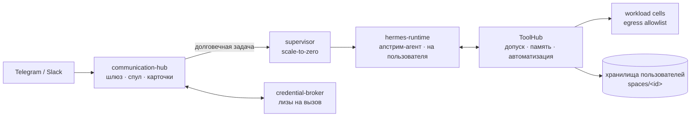

<p align="center">
  <a href="README.md">English</a> · <strong>Русский</strong>
</p>

# hermes-hub

[](https://github.com/letya999/hermes-hub/actions/workflows/ci.yml)
[](LICENSE)
[](go.mod)
[](https://github.com/letya999/hermes-hub/milestones)

**Обёртка надёжности и безопасности вокруг апстрим-агента
[Hermes](https://github.com/nousresearch/hermes-agent).** Go-контрольная
плоскость превращает однопользовательский CLI-агент в self-hosted
мультипользовательский appliance: агент живёт в Telegram, получает инструменты
через политик-шлюз, трогает секреты только на один вызов, переживает рестарты
и делит хост с другими изолированными пользователями.

Hermes думает; hermes-hub делает его безопасным для реальных людей —
долговечные очереди, scale-to-zero супервизия, допуск инструментов на вызов,
брокеринг креденшелов и аудируемый след всего произошедшего.

## Зачем хаб вокруг Hermes

Голый агент — это общее окружение, зашитые в env токены, отсутствие изоляции
тенантов и невозможность ответить «кто разрешил этот вызов». hermes-hub
оборачивает его:

| Проблема | Голый agent CLI | hermes-hub |
|---|---|---|
| Секреты | env-переменные в процессе агента | credential broker — лизы на вызов, значения не доходят до чата, логов и аудита |
| Доступ к инструментам | что настроено, то и есть | допуск ToolHub — default-deny, права принципала проверяются на каждом вызове |
| Конфигурация | россыпь конфиг-файлов | шесть авторских паспортов — единственный авторитет, атомарные ревизии, fail-closed компиляция |
| Мультиюзер | один пользователь, одна машина | изоляция `spaces/<id>` — свои хоумы, хранилища, egress, потолки организаций |
| Надёжность | процесс умер — работа потеряна | долговечный спул задач, квитанции, ограниченные журналы, супервизор рестартов |
| Стоимость простоя | контейнер всегда включён | supervisor scale-to-zero — тёплый лиз 30 минут, холодный restore |
| Аудит | нет | ограниченный аудит-леджер — у каждого допущенного вызова есть долговечная причина |

## Как это работает — четыре сценария

1. **Личный агент в вашем мессенджере.** Пишите или говорите ему в Telegram
   (Slack тоже работает): он держит диалог, исполняет задачи и возвращает
   документы, картинки и видео прямо в чат. STT и TTS — встроенные сервисы,
   голосовые работают из коробки.
2. **Командный агент под потолком политики.** Организационный space несёт
   членство, одобренные коннекторы и общие скиллы. У каждого участника —
   изолированные runtime и хранилище; орг может сужать права, но не расширять.
3. **Автоматизация, переживающая сессию.** Рутины, вотчеры сайтов,
   долгоживущие назначения и персональный dreaming крутятся в ToolHub —
   срабатывают, пока ни один агент не проснулся, а результаты приходят
   обычными сообщениями.
4. **Безопасный способ дать модели реальные инструменты.** Подключайте
   MCP-серверы, GitHub, браузер, SSH или файлы. Каждый вызов проходит допуск
   ToolHub, креденшелы выдаются на один вызов, а аудит-леджер отвечает «кто
   это разрешил».

## Архитектура



Шлюз владеет диалогом; супервизор поднимает runtime нужного пользователя по
требованию и гасит простаивающие вычисления. ToolHub решает, какие инструменты
модель увидит *для этого принципала*; брокер выдаёт креденшелы на вызов вместо
впечатывания их в окружение. Каждое решение о допуске падает в ограниченный
аудит-леджер.

## Сравнение с альтернативами

### Бесплатные и открытые

| Проект | Тип | Мультиюзер | Секреты | Допуск / аудит | Долговечные запуски | Своя память |
|---|---|---|---|---|---|---|
| **hermes-hub** | self-hosted agent appliance | ✅ per-space | брокер, на вызов | ✅ | ✅ + scale-to-zero | ✅ хранилище |
| hermes-agent (голый) | agent CLI | ❌ | env-переменные | ❌ | ❌ | ⚠️ файлы |
| OpenClaw | личный шлюз агента | ❌ | ⚠️ | ⚠️ | ⚠️ | ⚠️ |
| Eve | harness-фреймворк | строите сами | ⚠️ | ⚠️ | ❌ | ⚠️ |
| NanoClaw | минимальный harness | ❌ | ❌ | ❌ | ❌ | ❌ |
| IronClaw | hardened runtime | ⚠️ | ⚠️ | ⚠️ | ⚠️ | ⚠️ |
| OpenDuet | парный harness | ⚠️ | ⚠️ | ⚠️ | ⚠️ | ⚠️ |
| OpenDot | фреймворк агентов | строите сами | ⚠️ | ⚠️ | ⚠️ | ⚠️ |
| Paperclip | платформа агентов | ⚠️ | ⚠️ | ⚠️ | ⚠️ | ⚠️ |

### Коммерческие ассистенты и боты

| | hermes-hub | Muse (Meta) | OpenAI Dot | Claude Duet | Grok (xAI) | Instinct |
|---|---|---|---|---|---|---|
| Self-hosted, ваша инфраструктура | ✅ | ❌ | ❌ | ❌ | ❌ | ❌ |
| Свой выбор модели и провайдера | ✅ | ❌ | ❌ | ❌ | ❌ | ❌ |
| Изоляция пользователей | ✅ | ❌ | ❌ | ❌ | ❌ | ❌ |
| Допуск инструментов + аудит | ✅ | ❌ | ❌ | ⚠️ | ❌ | ❌ |
| Секреты не покидают ваш хост | ✅ | ❌ | ❌ | ❌ | ❌ | ❌ |
| Память — ваши файлы | ✅ | ⚠️ облако | ⚠️ облако | ⚠️ облако | ⚠️ облако | ⚠️ облако |
| Открытый код / бесплатно | ✅ AGPL | ❌ | ❌ | ❌ | ❌ | ❌ |

Ниша меняется быстро — ⚠️ означает «частично или не в фокусе продукта»;
проверяйте актуальное состояние, прежде чем закладываться на ячейку.

## Быстрый старт

Нужен Docker Engine/Desktop с Compose 2.30+. Возьмите бинарь под вашу
платформу из последнего релиза; Go нужен только для сборки из исходников.

```bash
./bin/hubctl-linux-amd64 init --user artem
# Отредактируйте spaces/artem/passports/{stack,config,models,workspace,tools,grants}.yaml и secrets.prod.env
./bin/hubctl-linux-amd64 space apply --dir spaces/artem --env prod --confirm
./bin/hubctl-linux-amd64 doctor --user artem
./bin/hubctl-linux-amd64 up --user artem --env prod
./bin/hubctl-linux-amd64 chat --user artem
```

Задайте проверенный маршрут по умолчанию в `passports/models.yaml` и креденшел
провайдера в `secrets.prod.env`. На Windows — прилагаемый `.exe` и Docker
Desktop Linux containers. Закладывайте 4 vCPU, 8 GB RAM, 30 GB свободного
диска — сайзинг под мультиюзер см. [Требования к ресурсам](#требования-к-ресурсам).
Подробный русский гид: [START_HERE.ru.md](START_HERE.ru.md).

## Организации

Пользователи и организации делят один namespace (`spaces/<id>`). Организация
несёт членство, одобренные коннекторы, общие скиллы и потолки политики —
участники могут сужать, но не расширять.

```bash
./bin/hubctl-linux-amd64 org-init --org acme --user artem
./bin/hubctl-linux-amd64 init --org acme --user artem
./bin/hubctl-linux-amd64 org sync-members --org acme --org-dir spaces/acme
```

## Требования к ресурсам

Честные инженерные оценки с dev-стека, а не маркетинговые бенчмарки —
промеряйте под свою нагрузку перед покупкой VPS.

**База (всегда включённая контрольная плоскость):** supervisor,
communication-hub, ToolHub, credential-broker, model-relay — около **1 vCPU /
2 GB RAM** в простое, плюс ~5 GB образов хаба на диске.

**На пользователя:**

- остановленный runtime: ~0 CPU/RAM — на диске остаётся только состояние
- тёплый/активный runtime: **~0.3–0.5 vCPU / 0.5–1 GB RAM**
- опциональный браузер-сайдкар: **+0.5 vCPU / 1–2 GB RAM**
- голос (STT/TTS): общий пул сервисов, ~1–2 GB RAM суммарно
- диск: ~0.5–2 GB на пользователя (vault, workspace, state) — больше при
  тяжёлой работе с медиа

Супервизор scale-to-zero значит: сайзинг считается по **одновременно
активным** пользователям, а не по зарегистрированным. ~30% онлайн
одновременно — безопасное допущение по умолчанию.

| Развёртка | Допущение | vCPU | RAM | Диск |
|---|---|---|---|---|
| 1–2 юзера | 1 активный runtime + браузер | 4 | 8 GB | 30 GB |
| 10 юзеров | ~3 одновременных runtime | 4–6 | 12 GB | 60 GB |
| 100 юзеров | ~30 одновременных runtime | 16–24 | 48 GB | 300+ GB |

Один Docker-хост упирается примерно в строку «10 юзеров» — за ~30
runtime оверхед контейнеров и образов становится узким местом. Именно под эту
нагрузку предназначен roadmap microVM/Kubernetes.

## Roadmap

- **Изоляция через microVM** — пользовательские runtime в выделенных
  microVM вместо контейнеров, для более жёсткой границы безопасности.
- **Kubernetes** — оркестрация контрольной плоскости и runtime по нескольким
  хостам; строка «100 юзеров» становится горизонтальным, а не вертикальным
  масштабированием.
- **Bare metal** — установка на чистый Linux-хост без Docker Desktop.

## Перечень фичей

97 инструментов модели в 21 first-party семействе плюс запиненный
платформенный слой — всё ниже проходит через допуск ToolHub:

- **Чат-каналы:** Telegram в первую очередь + Slack — текст, голосовые,
  файлы на вход; карточки, документы и медиа обратно. Локаль интерфейса на 4
  языка для каждого пользователя.
- **Голос и речь:** сервис faster-whisper STT, сервис TTS,
  `media_transcribe` с измеренными сегментами времени, `media_speak` — речь в
  очередь доставки чата.
- **Файлы и воркспейс:** полная файловая поверхность (`file_list/read/
  search/write/edit/mkdir/archive/remove`) по допущенным корням — workspace,
  archive, organization, skills, knowledge; записи с защитой ревизий;
  `project_create` для новых проектных директорий; входящая передача файлов.
- **Документы:** extract/create/edit/convert/remove для txt, md, csv, html,
  pdf, xlsx, pptx, webp — всё внутри допущенного скоупа, без внешних
  конвертеров в базовом образе.
- **Медиа:** инспекция 1–8 картинок за вызов, конвертация, генерация картинок
  и видео (CLIProxy/Fal), fetch, транскрибация, озвучка.
- **Память и воспоминания:** персональное markdown-хранилище (листья →
  типизированные карточки → свёрнутые суммаризации → CORE.md), BM25+граф
  `memory_search` с эвиденсами file:line, управляемые записи `memory_card`,
  подтверждаемые владельцем, детерминированный ночной rollup, dreaming,
  read-only ссылки `memory_open` + поверхность OpenKnowledge.
- **Автоматизация:** рутины (once/after/cron/оконные интервалы), вотчеры
  сайтов со Starlark-фильтрами до 32 источников, подписки на события,
  долговечные назначения, цели на диалог.
- **Сессии и параллельная работа:** именованные сессии как хэндлы задач чата —
  list/search/read/create/switch/archive; conversation lanes крутят
  параллельные сессии внутри одного контекста с fairness по контексту;
  ограниченный пул воркеров шлюза.
- **Управление контекстом:** компакция двух движков (хабовский каскад
  «сначала дешёвое» + нативный Hermes), живой подсчёт токенов, `context_edit`
  на границе хода.
- **Терминал и CLI:** ограниченные `terminal_exec`/`terminal_job` —
  разрешённый бинарь, фиксированный argv, снапшот workspace как cwd, без
  shell, фоновые задачи; bounded-CLI транспорт коннекторов с ячейками,
  проверенными контроллером; приватные ячейки пакетов.
- **SSH:** только задекларированные хосты — read/write/exec, интерактивный
  `ssh_shell`, проброс портов `ssh_tunnel`.
- **Коннекторы и MCP:** курируемый каталог (GitHub, GitLab, Google Workspace,
  Slack, Atlassian, личный Telegram) за 9-глагольной поверхностью
  `connector_*`; prepared-источники с дайджестами тиров, командные
  подключения, OAuth по рецептам, одноразовые ссылки действий; сырые
  `user_mcp`/`org_mcp` для некурируемых серверов.
- **Браузер:** Chromium на подключение с изолированным профилем,
  `browser_open/read/act/capture`, одноразовые viewer-ссылки владельца,
  deny-first веб-egress прокси.
- **Веб и исследования:** `web_search`/`web_fetch`/`web_search_multi` с
  allowlist провайдеров и кэшем, долговечные задачи `research_*`
  глубокого ресёрча.
- **Сайты и exposure:** публикация и хостинг статических сайтов на
  пользователя, слой DNS/TLS, именованные sish-туннели (`exposure_*`),
  поддомены на пользователя.
- **Модели:** Model Relay на владельца — `model_list`/`model_switch`,
  ограниченные лестницы фолбэка, учёт использования.
- **Скиллы:** формат agentskills.io, `skill`/`skill_search`/`skill_edit` с
  записью только драфтами, публикация через карточку одобрения, нормализация
  совместимости (Hermes/OpenClaw/Codex/Claude Code), запиненные
  git-установки.
- **Настройки и конфиг:** шесть авторских паспортов как единственный
  авторитет конфигурации, `settings_read`/`settings_edit` по проверенному
  allowlist, публикация с защитой ревизий.
- **Управление:** допуск ToolHub default-deny, словарь `rights.yaml`,
  PDP/PEP, ограниченный аудит-леджер, лизы креденшелов на вызов от брокера.
- **Эксплуатация:** супервизор scale-to-zero, долговечный спул с квитанциями,
  SQLite-хранилища root-сервисов, ограниченные журналы, раскатки image-pin,
  экспорт `usage.jsonl`.

## Инженерия

`just check` — быстрый локальный гейт (формат, доки, vet). GitHub Actions
владеет полным race/shuffle-набором, покрытием ≥85%, секьюрити-анализом и
контейнерной приёмкой. См. [CONTRIBUTING](CONTRIBUTING.md).

- [SETUP](SETUP.md) — бутстрап аккаунтов, VPS, нативные инструменты
- [Архитектура](docs/architecture.md) · [Операции](docs/operations.md) · [Валидация](docs/validation.md)
- [Memory Bank](docs/index.md) — правила / решения / замороженные спеки / планы
- [Гигиена документации](docs/status-hygiene.md) — как статусы записей остаются честными

## Лицензия

[AGPL-3.0-only](LICENSE) на оригинальный код; апстрим-компоненты сохраняют свои
лицензии. Hermes — зависимость, а не код, который этот репозиторий патчит.
